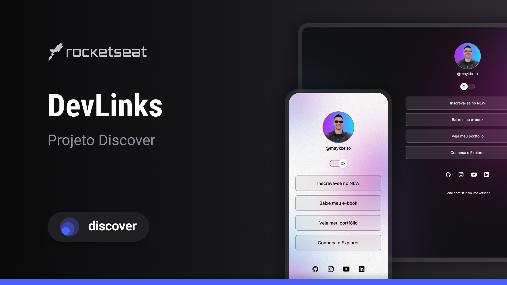

<h1 align="center">DevLinks</h1>

  

## 💻 Sobre o projeto

DevLinks é uma página de links com perfil, botões e alternância entre tema claro e escuro.
Projeto desenvolvido no programa gratuito Discover, da Rocketseat.

## 🚀 Tecnologias

- HTML
- CSS
- JavaScript
- Git e GitHub
- Figma

## 🎨 Layout

O layout foi criado no Figma: [acesse aqui](https://www.figma.com/design/2FTbDirfiNf9CCDRCNXeeR/DevLinks-%E2%80%A2-Projeto-Discover--Community-?node-id=10-620)

## 📄 Licença

Este projeto está sob a licença MIT.

Feito com ❤️ pela Rocketseat.